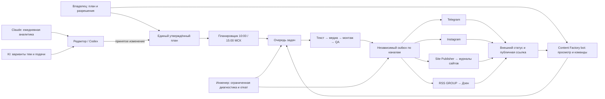

# Контент-завод INTOR: от плана до подтверждённой публикации

**Контекст.** Для INTOR GROUP и INTOR TECH нужны два ежедневных окна выпуска. Старые publisher, бот и план создавали конкурирующие маршруты; ошибка генерации или шаблона сайта могла сорвать выпуск, а повтор задачи — создать дубликаты.

## Актуальная схема на 17 октября 2026

Утверждённый план задаёт направление и расписание. Claude ежедневно ищет сигналы и предлагает редакционные действия с источниками; KI предлагает темы **в пределах плана**. Ни один из них не меняет план и не публикует самостоятельно. Планировщик создаёт задачи; worker готовит пакет, проверяет бюджет и качество, бот показывает материал владельцу и принимает разрешения. У каждого канала собственный статус и внешний ID. `pending` и `unknown` не считаются успехом и не запускают повторную отправку.

| Компонент | Ответственность |
|---|---|
| Владелец | Утверждает направление, платную генерацию и выпуск |
| Codex / редактор | Диагностика, проверка источников, сопровождение исправлений и релизов |
| Claude / KI | Аналитика и варианты тем, без права менять расписание или выпускать |
| Планировщик и worker | Задачи на 11:00 и 16:00 МСК, тексты по каналам, медиа, монтаж и QA |
| Outbox | Независимые попытки Telegram, Instagram, сайта и RSS; защита от дублей |
| Content Factory bot | Предпросмотр материалов, статусы, фиксированные команды инженеру |
| Инженер | Ограниченный перезапуск, сверка, журналируемый карантин и откат; без удаления исходников и неясных отправок |

## Что изменили

1. Оставили **один действующий контент-план** для обоих брендов. Старый publisher, старый бот и прежний план исключили из активного маршрута; Threads и Дзен TECH в него не входят.
2. Разделили подготовку, проверку качества, разрешение публикации и подтверждение доставки. Успешный запуск задания или ответ API сам по себе не равен опубликованному посту.
3. Ввели отдельное состояние каждого канала. При сбое повторяется только канал с доказанным отказом; неизвестные отправки сначала сверяются с платформой.
4. Дали инженеру ограниченные действия по восстановлению. Перед изменением кода — резервная копия, тест, установка с проверкой и откатом. Временные файлы уходят в журналируемый карантин; план, исходники и история отправок не удаляются автоматически.
5. Исправили Site Publisher для новой разметки журнала. Две статьи GROUP восстановили **только на сайте**, не отправляя повторно уже вышедшие Telegram и Instagram.

## Проверяемый результат

17 октября четыре пакета (по два на бренд) получили публичные ссылки в Telegram, Instagram и журналах сайтов. Instagram дополнительно показал статус `Published`; ссылки и страницы на момент проверки отвечали HTTP 200. Примеры: [GROUP Telegram](https://t.me/help_cad/143), [GROUP Instagram](https://www.instagram.com/p/DemK9YxCB6z/), [GROUP статья](https://intorgroup.ru/journal/nekapitalnyy-obekt-moskva-636-pp-1255-pp/), [TECH Telegram](https://t.me/intortech/18), [TECH Instagram](https://www.instagram.com/p/DemK9SwCMle/), [TECH статья](https://intor.tech/journal/api-ne-oznachaet-gotovnost-integratsii/).

Выпуски 11:00 в этот день вышли с опозданием. Импорт двух GROUP-материалов в Дзен через RSS остался **неподтверждённым**; неизвестный результат не повторяли. Точечное исправление Site Publisher ещё нужно включить в следующий неизменяемый релиз, а старые записи outbox согласовать с уже опубликованными URL. Эти ограничения не скрываются за формулировкой «всё работает без сбоев».

**Работы по кейсу:** разбор старых и новых маршрутов, дизайн безопасной очереди, контроль бюджета и QA, диагностика инцидента, адресное восстановление сайта и внешняя проверка публикаций.

[Вернуться к портфолио](../README.md)
