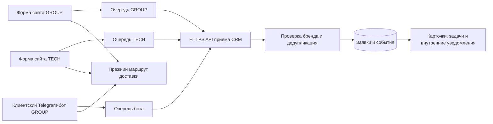

# INTOR CRM: сайты, бот и заявки в одном рабочем контуре

**Контекст.** INTOR GROUP и INTOR TECH получают обращения через собственные сайты; у GROUP есть отдельный клиентский Telegram-бот. Нужно видеть заявки по брендам в CRM, не нарушив существующую доставку и не смешав доступ сотрудников.

## Архитектура

Источники пишут в CRM **параллельно прежнему маршруту**. У каждого источника своя очередь и ключ, привязанный к бренду. Внешний ID позволяет безопасно повторить доставку после временной ошибки: то же событие не создаёт вторую карточку, а изменённый запрос с тем же ID отклоняется. В интерфейсе есть отдельные представления GROUP и TECH; права проверяются на сервере.

CRM развёрнута в отдельном приложении с PostgreSQL, фоновым обработчиком и HTTPS. Она логически отделена от сайтов и контент-завода. Размещение на одном VDS с сайтом GROUP означает общий риск отказа хоста — это отмечено в плане развития.

## Что проверено 17 октября 2026

| Маршрут | Проверка | Результат |
|---|---|---|
| Форма INTOR GROUP → CRM | Одна маркированная тестовая заявка через публичную форму | HTTP 201, одна карточка бренда GROUP, одно событие и одно внутреннее уведомление |
| Форма INTOR TECH → CRM | Тестовая заявка через публичную форму | HTTP 201, одна карточка бренда TECH |
| Клиентский Telegram-бот GROUP → CRM | Тест после полного согласия в боте | Очередь доставила событие с первой попытки, в CRM одна карточка; прежнее сообщение владельцу сохранено |
| Сборка CRM | Проверка приложения, worker и БД; локальные тесты | Компоненты healthy, 100 тестов прошли |

Проверки выполнены на тестовых и маркированных заявках. Это подтверждает сквозной маршрут, **но не заменяет** длительную сверку реальных заявок и операционную приёмку.

## Что ещё предстоит

- Сверить исходные журналы и CRM за продолжительный период, контролировать ошибки очередей.
- Настроить выносную резервную копию и регулярно проверять восстановление.
- Завершить приёмку ролей и процессов сотрудников.
- Внутренние уведомления уже создаются в CRM; доставка этих уведомлений в Telegram пока не подтверждена и здесь не заявляется.

**Работы по кейсу:** декомпозиция интеграции, изоляция источников и брендов, очереди с защитой от дублей, проверки сквозных маршрутов и документирование границ готовности.

[Вернуться к портфолио](../README.md)
